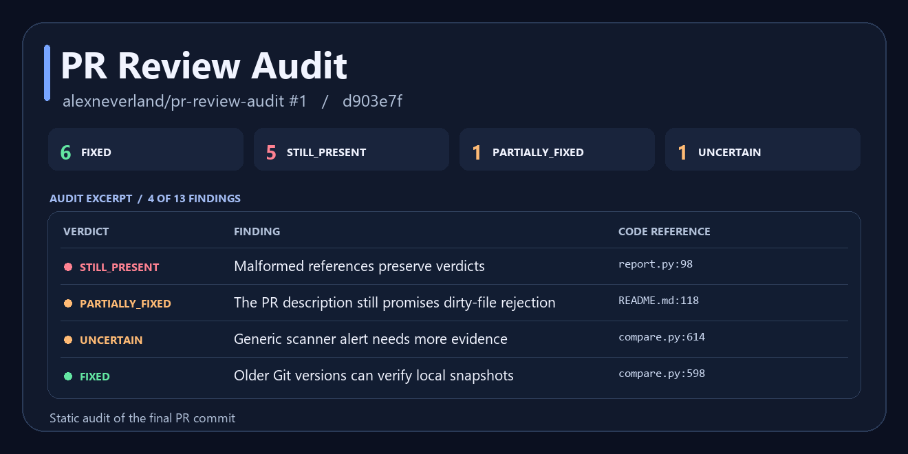

# PR Review Audit

Verify whether earlier GitHub pull request findings were fixed in the latest PR commit. Run PR Review Audit as a standalone skill in Codex or Claude Code.

[Latest release](https://github.com/alexneverland/pr-review-audit/releases/latest) · [Example report](pr-review-audit/examples/sample-audit-report.md) · [MIT License](LICENSE)



*Excerpt from a real audit of [this repository’s PR #1](https://github.com/alexneverland/pr-review-audit/pull/1). The verdicts refer to that PR's final commit.*

## Why PR Review Audit?

After a round of fixes, review comments may point to old code, and resolved threads can still describe problems present in the latest commit. Give the skill a PR URL to get a table of existing findings, with a verdict and code evidence for each one. The full Markdown report includes links to the original comments and warnings about missing or outdated evidence.

| Verdict | Meaning |
| --- | --- |
| 🟢 `FIXED` | The current code addresses the review concern. |
| 🟠 `PARTIALLY_FIXED` | Part of the concern still needs work. |
| 🟠 `UNCERTAIN` | The available evidence is insufficient or runtime verification is needed. |
| 🔴 `STILL_PRESENT` | The issue remains in the current code. |

## Architecture

Deterministic data collection, commit-freshness comparison, file tracking, and report rendering live in zero-dependency Python 3.11+ scripts; semantic verification is performed by the host AI agent (Codex CLI or Claude Code) using the skill instructions.

```text
pr-review-audit/
├── SKILL.md                       # Portable skill instructions (Codex CLI & Claude Code)
├── scripts/
│   ├── __init__.py
│   ├── collect.py                 # Paginated GraphQL + REST collection via `gh api`
│   ├── compare.py                 # Freshness analysis, rename/moved-code tracking, snapshots
│   └── report.py                  # Guardrail validation, sanitization, Markdown rendering
├── references/
│   └── verification-rules.md      # Classification rubric & prompt-injection defenses
├── tests/
│   └── test_pr_review_audit.py    # Mocked unit & scenario tests (stdlib unittest)
└── examples/
    └── sample-audit-report.md     # Example audit report output
```

### Review Freshness States

- `CURRENT`: Review commit matches PR `HEAD`.
- `OLDER_UNAFFECTED`: Chronologically older than `HEAD`, but later commits did not modify the reviewed file.
- `OLDER_AFFECTED`: Chronologically older than `HEAD` and subsequent commits modified the reviewed file or PR scope.
- `COMMIT_NOT_IN_HISTORY`: Review commit SHA is absent from current PR commits (force-push, rebase, or squash).
- `UNKNOWN_COMMIT`: GitHub metadata lacked a commit SHA (e.g., issue comments or orphaned review metadata).

## Prerequisites

- **Python 3.11+** (standard library only; no `pip install` needed)
- **GitHub CLI (`gh`)** authenticated for the target GitHub or GitHub Enterprise host (`gh auth login`)

## Installation

Download and extract the [portable skill ZIP](https://github.com/alexneverland/pr-review-audit/releases/latest/download/pr-review-audit.zip), or clone the repository:

```bash
git clone https://github.com/alexneverland/pr-review-audit.git
cd pr-review-audit
```

### Codex CLI

Copy or symlink `pr-review-audit/` into your Codex user skills directory or repository skills directory:

- **Global (user-wide):**
  - macOS / Linux:
    ```bash
    mkdir -p ~/.codex/skills
    cp -R pr-review-audit ~/.codex/skills/pr-review-audit
    ```
  - Windows (PowerShell):
    ```powershell
    New-Item -ItemType Directory -Force "$HOME\.codex\skills" | Out-Null
    Copy-Item -Recurse -Force ".\pr-review-audit" "$HOME\.codex\skills\pr-review-audit"
    ```
- **Project-local:** copy `pr-review-audit/` to `<repo>/.agents/skills/pr-review-audit`.

Invoke in Codex CLI:

```text
Use $pr-review-audit to verify whether the issues raised in https://github.com/owner/repo/pull/123 are actually fixed in the latest commit.
```

### Claude Code

Copy or symlink `pr-review-audit/` into your Claude Code skills directory:

- **Global (user-wide):**
  - macOS / Linux:
    ```bash
    mkdir -p ~/.claude/skills
    cp -R pr-review-audit ~/.claude/skills/pr-review-audit
    ```
  - Windows (PowerShell):
    ```powershell
    New-Item -ItemType Directory -Force "$HOME\.claude\skills" | Out-Null
    Copy-Item -Recurse -Force ".\pr-review-audit" "$HOME\.claude\skills\pr-review-audit"
    ```
- **Project-local:** copy `pr-review-audit/` to `<repo>/.claude/skills/pr-review-audit`.

Invoke in Claude Code:

```text
/pr-review-audit https://github.com/owner/repo/pull/123
```

## Standalone CLI Pipeline

You can also run the deterministic helper scripts directly:

```bash
python pr-review-audit/scripts/collect.py "https://github.com/owner/repo/pull/123" --output /tmp/collected.json
python pr-review-audit/scripts/compare.py /tmp/collected.json --fetch-diffs --fetch-files --output /tmp/audit-context.json
# After creating /tmp/findings.json per pr-review-audit/SKILL.md:
python pr-review-audit/scripts/report.py --context /tmp/audit-context.json --findings /tmp/findings.json --output /tmp/report.md
```

When run as a skill, Codex or Claude Code shows a findings table directly in chat and links the full Markdown report. [Example report](pr-review-audit/examples/sample-audit-report.md)

## Running Tests

All automated tests use mocked `gh api` responses and require no network access or GitHub tokens:

```bash
python -m unittest discover -s pr-review-audit/tests -v
```

## Contributing

Fork the repository and open a pull request against `main`. Include an example or a regression test if your change affects an audit verdict, source lookup, or report. See [AGENTS.md](AGENTS.md) for the project checks and scope. GitHub Actions runs the project's required checks on pull requests. A maintainer may need to approve workflow runs from first-time contributors.

## Security & Reliability

- **Read-only by default:** Only issues GraphQL queries and REST `GET` requests via `gh api`; never modifies source code or posts GitHub comments without explicit permission.
- **No shell interpolation:** Validates PR URLs, owners, repos, numbers, and hosts strictly, invoking `gh` with `shell=False` and GraphQL `--input -`.
- **Untrusted input isolation:** Never executes repository scripts or tests; blocks local `--repo-dir` path traversal, verifies `--repo-dir` is a Git repository root matching PR `HEAD`, and reads committed `HEAD` blobs directly without applying Git filters (with `--fetch-files` taking precedence); sanitizes raw HTML/table characters in untrusted PR text.
- **Evidence guardrails:** `report.py` automatically downgrades `FIXED`, `STILL_PRESENT`, or `PARTIALLY_FIXED` findings to `UNCERTAIN` if `evidence` or `code_references` are missing.

## Explicit Limitations & Known Failure Cases

1. **Static verification only:** Does not execute unit/integration tests, linters, or migrations; runtime-only or infrastructure-dependent fixes must be classified `UNCERTAIN` and flagged for human verification.
2. **GitHub API truncation & size caps:** GitHub omits patches on binary or oversized files, caps `/pulls/{n}/files` at 3,000 files, caps `/compare` at 250 commits / 300 files, and caps `/contents` snapshots at 1 MB.
3. **Force-pushed / rebased commits:** If review commit SHAs are absent from PR history (`COMMIT_NOT_IN_HISTORY`), line offsets and commit-range diffs may be unavailable; verification relies on `diff_hunk` anchors and current `HEAD` files.
4. **Heavy cross-file rewrites:** If code was substantially rewritten across multiple files without git rename metadata or surviving anchor lines, moved-code matching may miss the destination and require manual lookup or `UNCERTAIN`.
5. **External/private dependencies:** Issues referencing behavior in uninspected repositories, runtime environment variables, or third-party services cannot be confirmed solely from the PR.

## Future Extensions (Out of Scope for MVP)

The `schema_version` (`"1.0"`) JSON boundary between `collect.py`, `compare.py`, and `report.py` is designed to later accommodate:
- Targeted regression analysis across callers
- Related test-coverage checks
- Incremental re-auditing & audit history
- Quick Audit vs. Full Audit modes
- Optional GitHub PR comment reporting & GitHub Actions integration

## License

[MIT](LICENSE). The portable skill includes a copy of the license.
